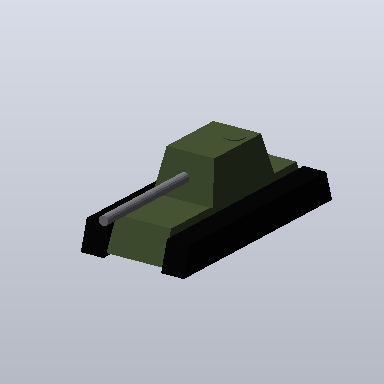
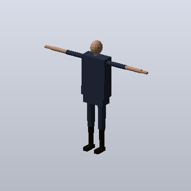
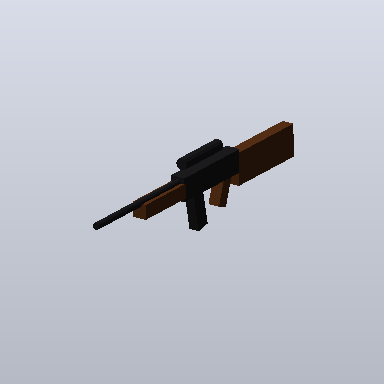

# Atelier 3D d'APEX — véhicules, armes et personnages pour Blender, Unity et Unreal

L'atelier construit des modèles 3D **paramétriques** : voiture, camion, char, moto ; épée, hache, fusil,
pistolet ; personnage humanoïde avec squelette. Le modèle de langage (le Cerveau APEX ou un modèle Ollama) décide
**quoi** construire, par exemple « un char de 7 m kaki ». L'atelier construit ensuite une géométrie exacte et
vérifiable, comme la calculatrice calcule : le modèle de langage ne dessine jamais de géométrie lui-même.

  

## 1. Utilisation

1. Dans l'assistant, choisissez le mode **3D** (ou le mode **Code**, qui a aussi l'outil).
2. Décrivez le modèle : « Modélise un char de 8 m de long, kaki », « une épée de 1,2 m », « un personnage costaud
   de 1,9 m ».
3. Le panneau **Atelier 3D** affiche l'aperçu, le résumé (dimensions réelles, pièces, triangles) et les fichiers.
   Un clic télécharge un fichier ; le dossier réel sur le PC est indiqué.

Paramètres reconnus :

| Générateur | Sortes | Paramètres (mètres) |
|---|---|---|
| `vehicle` | `car`, `truck`, `tank`, `motorbike` | `length`, `width`, `height`, `wheels`, `color` |
| `weapon` | `sword`, `axe`, `rifle`, `pistol` | `length`, `color` |
| `character` | `humanoid` | `height`, `build` (`slim`, `normal`, `strong`), `color` |

Couleurs : un nom (rouge, bleu, vert, noir, blanc, gris, jaune, orange, kaki, sable, violet, rose, marron, or,
argent, ou leur nom anglais) ou un code `#RRGGBB`. Une valeur hors bornes (un char de 100 m) est ramenée dans les
bornes, et le résumé le **dit** (« length ramené à 30 »).

## 2. Fichiers produits (dossier `modeles3d/` de l'espace de travail)

| Fichier | Pour | Contenu |
|---|---|---|
| `char.glb` | Blender, Unreal (natif), Unity (paquet glTFast), Godot | glTF 2.0 : pièces nommées, matériaux PBR, squelette et peau pour un personnage |
| `char.obj` + `char.mtl` | Unity (natif), tout logiciel 3D | maillage, Y vers le haut (convention OBJ) |
| `char_blender.py` | Blender | reconstruit le modèle (matériaux, pièces, squelette lié) ; en ligne de commande, exporte en `.glb` ou `.fbx` |
| `char.png` | aperçu | rendu logiciel de trois quarts |
| `ApexCharController.cs` | Unity | script de départ (C#) |
| `ApexCharPawn.h/.cpp` | Unreal Engine 5 | classe de départ (C++) |
| `char_LISEZ-MOI.txt` | vous | ce que contient chaque fichier, et ce qui a été vérifié |

Un nouveau modèle n'écrase jamais un ancien : `char`, puis `char-2`, `char-3`…

Scripts de départ (gabarits réglés sur les dimensions du modèle, pas du texte inventé) :

- **véhicule** : conduite arcade (accélération, freinage, rotation, sur place pour un char), roues qui tournent ;
- **arme à feu** : tir par rayon (cadence, chargeur, rechargement, dégâts) ; **arme blanche** : frappe en zone ;
- **personnage** : troisième personne (marche, course, saut, caméra) ; sous Unreal, `ACharacter` avec bras de
  caméra.

Les axes diffèrent d'un moteur à l'autre. Le script Unity tourne donc les pièces pour que l'avant du modèle (ses
phares, son canon ou ses pieds) soit l'avant de Unity. Les classes Unreal exposent `ForwardYawOffset`, à régler à
90, -90 ou 180 si le modèle regarde de côté.

### Pas à pas

- **Blender** : Fichier > Importer > glTF 2.0 (`char.glb`). Autre possibilité : onglet Scripting > Ouvrir
  `char_blender.py` > Exécuter. Pour un personnage, le squelette est lié : en mode Pose, tourner un os déplace le
  membre.
- **Unity** : glisser `char.obj` dans Assets, ou le `.fbx` obtenu par
  `blender -b --python char_blender.py -- char.fbx` (squelette compris). Ajoutez ensuite `ApexCharController.cs`
  sur l'objet et un Collider au véhicule et au sol.
- **Unreal** : glisser `char.glb` dans le Content Browser. Copiez `ApexCharPawn.h/.cpp` dans `Source/<Projet>/`
  et compilez. Créez un Blueprint dérivé et choisissez-y le maillage. Déclarez enfin les entrées dans Paramètres du
  projet > Input (MoveForward, MoveRight, et pour un personnage Turn, LookUp, Jump, Run).

## 2 bis. Extension Blender « APEX Atelier 3D »

Les mêmes générateurs, directement dans Blender, sans passer par l'assistant :
[`releases/blender/apex_atelier3d.zip`](../releases/blender/apex_atelier3d.zip) (empreinte SHA-256 dans le
fichier `.sha256` voisin).

1. Blender > Edit > Preferences > Add-ons > **Install…** > `apex_atelier3d.zip`, puis cocher
   « APEX Atelier 3D ».
2. Vue 3D > barre latérale (touche **N**) > onglet **APEX** : type, sorte, dimensions (cocher celles à imposer),
   morphologie, couleur > **Construire**. Le modèle apparaît au curseur 3D.

L'extension ne fait rien d'autre : aucun accès réseau, aucun fichier écrit, aucune dépendance hors de Blender.
Elle construit chaque modèle avec le même code que le script Blender d'APEX. Ses objets sont tenus par référence :
deux personnages dans la même scène ont chacun leur squelette, qui déplace leurs propres pièces. Archive
reproductible : un test vérifie que le fichier publié est exactement celui que produit le code actuel
(régénération : `python scripts/build_blender_addon.py`).

## 3. Ce qui est vérifié (avec les vrais outils, 12/10/2026)

| Vérification | Outil réel | Résultat |
|---|---|---|
| Chaque pièce est un volume fermé et orienté | trimesh (indépendant d'APEX) | 10 modèles, 106 pièces sur 106 (volume positif) |
| Le glTF est conforme | **validateur officiel Khronos** (`gltf-validator` 2.0.0-dev.3.10) | 10 modèles : 0 erreur, 0 avertissement (personnages avec peau compris) |
| Blender reconstruit le même modèle | **Blender 4.0.2** sans écran | mêmes pièces et triangles, dimensions au millimètre |
| Le squelette déplace bien les pièces | Blender : os `bras_G` tourné de 90° | main gauche déplacée de 0,97 m, tête et pied droit immobiles (0 m) |
| Les exports se réimportent | Blender : FBX et glTF du script, glTF d'APEX | 20 os, 16 pièces liées, 628 triangles (rien d'autre, pas de cube de départ) |
| L'extension Blender s'installe et construit | Blender 4.0.2 : installation de l'archive, construction | char, épée, deux personnages : mêmes pièces, triangles et os que les générateurs ; chaque personnage lié à son propre squelette (main déplacée de 0,97 m) |
| Le C# des scripts Unity compile | **compilateur C# Roslyn** (.NET 8), avertissements traités comme erreurs | 10 scripts sur 10 ; une faute volontaire est refusée |
| Le C++ des classes Unreal est valide | **g++** `-fsyntax-only -Wall -Wextra -Werror` | 10 classes sur 10 ; une faute volontaire est refusée |

**Limite de ces deux dernières lignes.** Ni Unity ni Unreal ne sont installables ici. Le C# et le C++ ont donc été
vérifiés contre une **déclaration minimale de leurs API**, écrite par APEX d'après leur documentation
(`tests/data/game_api_min/`). Ce contrôle prouve la syntaxe et la cohérence du code, mais pas son exécution dans
le moteur. Ces scripts restent à essayer dans Unity ou Unreal.

Tests : `tests/test_studio3d.py`. Le test Khronos s'exécute quand `APEX_GLTF_VALIDATOR_DIR` désigne un dossier où
`npm install gltf-validator` a été lancé.

## 4. Qui appelle l'atelier

- **Un modèle Ollama** (ou tout modèle de l'assistant) : il appelle l'outil `model3d.create` en JSON, comme les
  autres outils. Les fichiers sont écrits seulement si le tour en a la permission (mode 3D ou Code).
- **Le Cerveau APEX** : il écrit l'appel dans sa réponse (`vehicle("tank", length=7, color="kaki")`) et lit le
  résumé du modèle réellement construit. L'assistant écrit ensuite les fichiers avec l'outil `model3d.create`. En
  mode Normal, rien n'est écrit, et un message le signale.

Ses données d'instruction : des demandes en français et en anglais, traduites en appel (`apex/neural/model3d_tasks.py`). Le
score exige que le résumé de l'atelier pour l'appel attendu figure dans la réponse. Deux familles d'évaluation :
`model3d` (formulations vues, combinaisons de paramètres jamais montrées) et `model3d_heldout` (formulations
jamais montrées). Mesures : `docs/CERVEAU_APEX_V2.md`.

## 5. Ce que l'atelier ne fait pas

- Ce sont des modèles **low-poly de base** : ni sculpture, ni textures peintes, ni dépliage UV, ni animations.
  Ce sont des points de départ propres, à détailler dans Blender.
- La peau d'un personnage est **rigide** (chaque pièce suit un os à 100 %) : elle suffit pour animer et tester,
  mais pas pour des déformations organiques.
- Neuf sortes seulement. Une demande hors de ces sortes (un avion, un dragon) est refusée par l'atelier, et le
  refus est dit.
