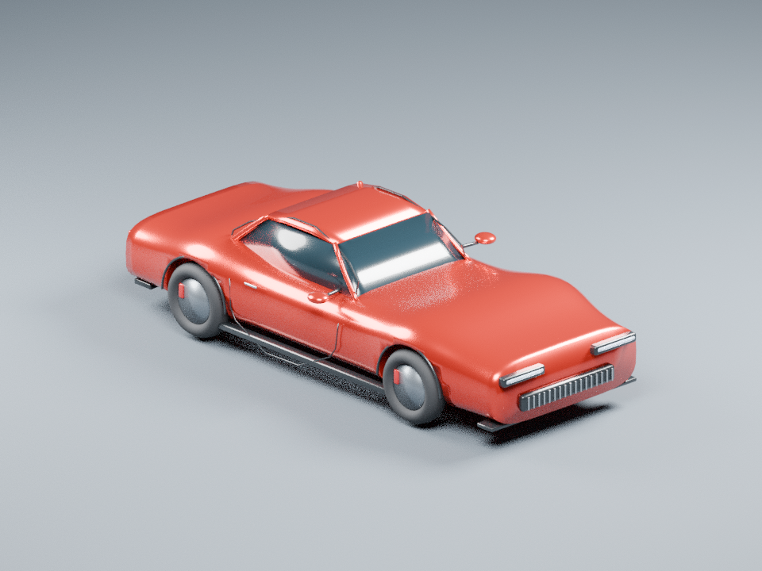

# Première création Windows — PR #29 / Issue #28

## Verdict

**READY WITH LIMITATIONS pour les composants Windows/Blender. La mission complète
APEX.exe → Qwen → Blender reste BLOCKED dans cet environnement**, faute des poids
Qwen vérifiés et d'accès effectif à l'installation Windows 11 de l'utilisateur.
Aucune génération Qwen ni performance RTX n'est inventée.

Le progrès démontré est une véritable création Blender sous Windows, dans le
runtime empaqueté APEX, avec correction, exports, réouvertures, contrôles et
ArtifactStore. La fixture artistique est explicitement séparée de la mission API.

## Modifications

- `apex/game_studio/gpu.py` : côté spécialiste du protocole request_gpu/return_gpu,
  vérification de l'ACK, profil/propriétaire, sérialisation des emprunteurs, bail
  existant, nettoyage et reçus. Raccordé aux services `service.py` et `project.py`.
- `runtime_build/build.py`, uniquement `_assemble_common` : inclusion du schéma
  véhicule manquant et copie canonique LF des contrats JSON. Empreinte Engineer
  inchangée ; aucune tolérance ajoutée au contrôle d'intégrité.
- `apex/game_studio/qualification.py`, `scripts/game_studio/qualify_windows.py`,
  workflow dédiée : qualification isolée, native, reproductible et bornée, sans
  téléchargement de poids par défaut.
- Tests de bail, ACK, concurrence, nettoyage, module manquant/cassé et packaging
  CRLF. Documentation des dépendances CPU/CUDA et du branchement attendu du Panel.

Aucun changement au cerveau, à l'assistant, au Panel, à l'installateur principal
ou au projet `C:\GameProject`. Aucune fusion ou release.

## Résultats réellement exécutés

| Capacité | Preuve | Limite |
|---|---|---|
| Python APEX Windows | NuGet CPython 3.12.10 x64, SHA256 vérifié | Windows Server 2022, pas le PC Windows 11 |
| Dépendances runtime et planner CPU | Deux locks installés, 56,1 s lors du run 2 | Installation dans un runtime isolé |
| llama-cpp-python 0.3.36 | DLL chargée, informations CPU, CLI serveur importée | Serveur avec modèle et inférence non exécutés |
| Blender 4.3.2 Windows | Voiture rouge, quatre vues par version, .blend et .glb | Catalogue procédural fixe, pas Qwen |
| Réouverture | .blend et .glb inspectés dans des processus Blender séparés | Pas Unreal |
| Correction | Refus des roues indépendantes → nouvelle version → `pass_preflight` | Pas de véhicule pilotable |
| Juge technique | PASS sur les versions complètes, artefacts intègres | Pas de certification esthétique/photoréaliste |
| ArtifactStore | Stockage réel, relecture et contrôle des octets | Fixture, pas faux artefacts de mission Qwen |
| API empaquetée Windows | 401 sans jeton, 200 authentifié, Game Studio servi | Pas de navigation graphique APEX.exe testée |
| Demande utilisateur réelle par API | 409 `local_planner_model_missing` | Mission BLOCKED, aucun plan simulé |
| GPU partagé | Gouverneur PR27 sur Linux CPU + exclusion interprocessus Windows native | Aucun modèle CUDA résident pendant ces essais |
| CUDA candidat | Roue officielle téléchargée, SHA et imports PE vérifiés | DLL NVIDIA nécessaires ; aucune exécution RTX |

### Essais Windows conservés

1. [Run 39078135909 — échec](https://github.com/chadown62-glitch/apex-ia-/actions/runs/39078135909),
   commit `3a1e80f`. La roue et Blender fonctionnent, mais le schéma a été converti
   en CRLF par Git Windows : 2661 octets / SHA `9b2d045c…`, au lieu de 2637 octets /
   SHA convenu `1ba53056…`. Le contrôle refuse correctement. La fixture omettait
   aussi le reçu `execution.json` après réparation ; le juge d'intégrité échoue.
   [Archive complète](evidence/windows-run1-failure.zip),
   [rapport](evidence/windows-run1-report.json).
2. [Run 39078665142 — succès des composants](https://github.com/chadown62-glitch/apex-ia-/actions/runs/39078665142),
   commit `744e580`. Copie LF canonique et véritable reçu du processus de
   réparation : juge PASS, Engineer PASS, API/front servi et blocage Qwen explicite.
   [Archive complète](evidence/windows-run2-success.zip),
   [rapport](evidence/windows-run2-report.json).

3. [Run 39079076348 — succès final](https://github.com/chadown62-glitch/apex-ia-/actions/runs/39079076348),
   commit `0fef466`. Même parcours réussi, cette fois avec le chemin réel
   `Blender portable\blender-4.3.2-windows-x64\blender.exe`. Un second processus
   est refusé pendant le bail (code 73), puis réussit après libération (code 0).
   [Archive complète](evidence/windows-run3-success.zip),
   [rapport](evidence/windows-run3-report.json), 143 fichiers vérifiés.

Les archives ont été vérifiées contre le SHA256 publié par GitHub Actions, puis
chaque fichier de leur manifeste a été re-haché. Elles préservent les .blend,
.glb, rendus, inspections, rapports, logs, mesures et objets ArtifactStore.
Aucun reçu de défaut n'a été retouché pour obtenir un PASS.

### Mesures CPU du run Windows 2

Windows Server 2022, quatre processeurs logiques, 17 174 360 064 octets de RAM.
Python : 3.12.10 MSC v.1943 AMD64. Blender : build `32f5fdce0a0a`.

| Étape | Temps écoulé | Temps CPU cumulé | Pic RSS échantillonné |
|---|---:|---:|---:|
| Première version et rendus | 140,156 s | 505,453 s | 295,195 MiB |
| Correction et nouveaux rendus | 132,703 s | 497,672 s | 262,770 MiB |
| Qualification entière, hors installation | 306,5 s | Non agrégé | Non agrégé |

Le dernier run confirme la répétabilité fonctionnelle : première version
159,906 s / 283,871 MiB, correction 154,704 s / 276,918 MiB ; qualification
349,969 s. Cette variation entre runners n’est pas une estimation RTX.

Le RSS est échantillonné toutes les 250 ms ; ce n'est pas un quota mémoire imposé
par Windows. Ces valeurs ne mesurent ni Qwen ni la RTX de l'utilisateur.

Sous Linux, le nouvel essai complet donne 77,256 s / 359,328 MiB pour la première
version et 66,933 s / 332,434 MiB pour la correction, avec juge et Engineer PASS.
Les [rapports locaux](evidence/linux-blender/blender-report.json) et le reçu de
[contrat du vrai gouverneur](evidence/governor-linux.json) sont conservés.

### Régressions

**117 tests passés, zéro échec, zéro skip**, en 33,831 s : API Game Studio,
contrôleur, planification, exigences, délégation, cycle de vie/budgets, dépendances,
baux GPU, contrats graphiques et packaging. [JUnit](evidence/backend-tests.xml).
Un avertissement existant de dépréciation Starlette/httpx reste visible.

Le frontend existant a été construit par npm ci + npm run build sur Windows ;
la page SPA a été servie par le vrai backend. Aucun composant frontend n'a été
modifié, aucun écran Windows interactif n'a été présenté comme testé. Les onze
échecs historiques de sandbox de #26 ne sont ni requalifiés ni transformés en PASS.

## GPU et coordination Claude

Le vrai module de PR27 `apex.models.gpu_handoff` a été lu au commit
`1bab1b030b7d62dfc3f8bed86f02310e452914de`, puis exécuté dans un test de contrat CPU
avec le bail OS réel et le scanner de processus actif. Aucun fichier Claude
n'a été modifié. Voir [GPU-CONTRACT.md](GPU-CONTRACT.md).

Le gouverneur doit encore refuser atomiquement un prêt déjà attribué et un retour
par un autre propriétaire. Le verrou Codex protège ses appelants ; il ne protège
pas des spécialistes qui contournent cette frontière. Recommandation publiée
avant la qualification RTX. La garde Game Studio CUDA demeure inchangée.

La roue officielle CUDA 12.4 est une candidate identifiée et vérifiée, **pas une
compatibilité validée**. Ses imports montrent qu'il faut aussi CUDA runtime,
cuBLAS, le pilote NVIDIA et les runtimes MSVC. Le lock candidat et le parcours de
construction depuis les sources sont décrits dans [PLANNER.md](PLANNER.md).
Ni téléchargement de poids ni entraînement ne sont exécutés dans ce lot.

## Étapes restantes pour la première mission dans APEX.exe

1. Intégrer après revue humaine les changements Codex empilés et le contrat
   gouverneur de #27, dans une nouvelle candidate isolée. #29 repose sur #26
   `d15fa02`, lui-même sur #24 → #22 → #19 ; les contributions Graphics/Engineer
   antérieures sont déjà dans cette pile. Ne pas rejouer leurs commits en double.
   `apex/integration` est toujours `bd2edd285ad2f796991ce5460715cb4ee9f3f06c`.
2. Claude raccorde les diagnostics et l'installation explicite des dépendances
   au Panel existant. Fournir le schéma véhicule canonique, les workers, Blender
   et le serveur local. Préserver le même APEX_HOME, l'UTF-8 du processus et son
   overlay torch CUDA ; ne pas écraser celui-ci avec le lock CPU de qualification.
3. Proposer le consentement humain pour les poids Qwen épinglés si absents,
   utiliser le helper d'installation et vérifier le manifeste/hash. Ne pas faire
   passer l'import de la bibliothèque pour une planification exécutée.
4. Pour le premier essai fonctionnel, faire choisir **CPU explicitement** dans
   l'application. Transmettre la demande de référence et les options juges/
   corrections via les contrats existants. Vérifier vrai plan Qwen, missions,
   versions, téléchargements SHA256 et rendus depuis le frontend APEX.exe.
5. Qualifier ensuite le cycle quiescence → bail → Qwen CUDA → libération → cerveau
   sur la RTX réelle, y compris concurrence, OOM et annulation. Lever la garde
   seulement après preuve. UE5 et la conduite restent hors qualification.

Le détail de répétition automatisée est dans [QUALIFICATION.md](QUALIFICATION.md).
Aucune intervention sur le PC personnel n'a été demandée pendant ces travaux.
