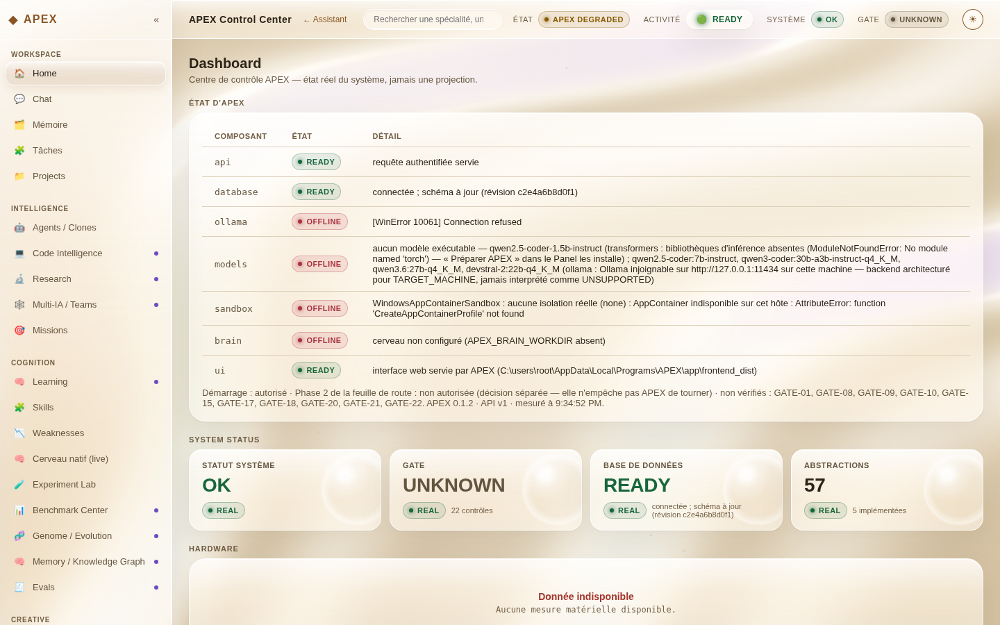
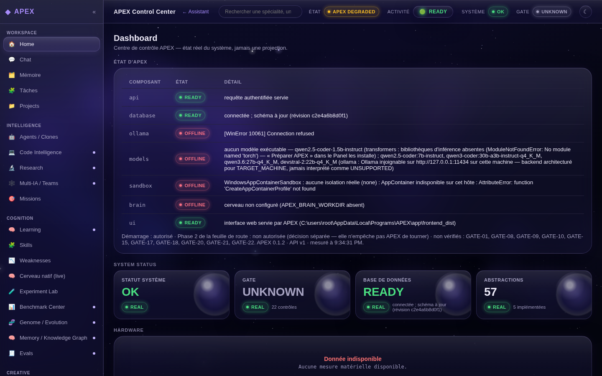
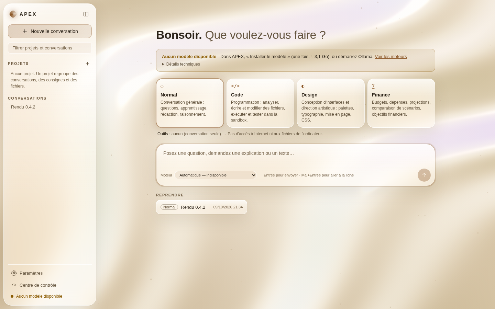
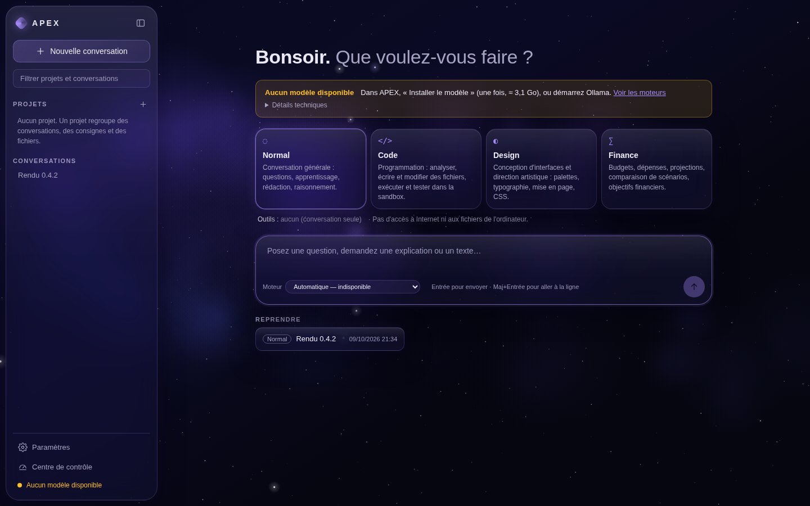

# APEX pour Windows — APEX.exe 0.4.2

| | |
|---|---|
| Installateur | `APEX-Setup-x64-v0.4.2.exe` (40 503 492 octets, Windows 10/11 64 bits, sans droits administrateur) |
| SHA-256 | `85625a2231fa736c60f9639e06a936ea3e5e7a75145777481608d30622987f1d` (fichier `.sha256` à côté) |
| Construit depuis | commit `cc7a0f23523fa369a91027e21eaae64e89cda587` — détail dans `manifest.json` |
| Signature | aucune (aucun certificat de signature de code) : Windows SmartScreen peut demander confirmation |
| Version précédente | 0.4.1 : toujours disponible dans l'historique (commit `c2f1719`, même dossier) |

APEX tourne **directement sous Windows** : ni WSL, ni Docker, ni terminal. Nouveau en 0.4.2 : **le rendu
graphique**, d'après les maquettes claire et sombre. Rien d'autre ne change (mêmes pages, mêmes boutons, mêmes
données).

- **APEX Dune (clair)** : fond de soie ivoire aux reflets nacrés ; barre latérale, barre du haut, panneaux et
  tuiles en verre dépoli.
- **APEX Night (sombre)** : ciel profond, nébuleuse violette et étoiles ; verre sombre au reflet brillant et
  au halo violet.
- **Tuiles d'état** avec une bulle de verre ; valeur en vert quand elle dit OK ou READY, en rouge pour un
  échec, atténuée pour UNKNOWN. **Pastilles** READY (vert), OFFLINE (rouge, nouvelle), DEGRADED (ambre),
  lumineuses en Night.
- Lisibilité **mesurée sur l'image rendue** (texte masqué, fond réel sous chaque texte, deux thèmes, écran
  100 % et 150 %) : tout texte courant ≥ 4,5:1.
- Thème : bouton ☾/☀ en haut à droite du centre de contrôle, ou **Paramètres → Apparence**.

Aperçu — l'interface servie par l'application Windows installée (captures prises sous Wine, 1440×900) :

| APEX Dune | APEX Night |
|---|---|
|  |  |
|  |  |

**Mise à jour depuis 0.4.1** : lancez simplement ce nouvel installateur (fermez d'abord APEX). Données,
conversations, réglages et modèle sont conservés ; la liste des bibliothèques n'a pas changé (même empreinte) :
**pas besoin de refaire « Préparer APEX »**.

1. **Télécharger** : ouvrez `APEX-Setup-x64-v0.4.2.exe` dans GitHub puis **Download raw file**.
   Vérification facultative (PowerShell) : `Get-FileHash .\APEX-Setup-x64-v0.4.2.exe -Algorithm SHA256`.
2. **Installer** : double-clic (« Informations complémentaires » → « Exécuter quand même » si SmartScreen
   s'affiche).
3. Première installation seulement : **Préparer APEX** (≈ 190 Mo), puis **Installer le modèle** (≈ 3,1 Go).
4. **Démarrer APEX** : l'assistant s'affiche dans la fenêtre dès qu'APEX répond. Choisissez le moteur et le
   mode, écrivez votre message, Entrée.
5. **Arrêter APEX** pour l'arrêter proprement ; projets, conversations et réglages sont conservés.

Premier lancement, moteurs, modes, projets et dépannage : [`docs/INSTALLER_APEX.md`](../../docs/INSTALLER_APEX.md).
Ce qui a été vérifié, et ce qui ne l'a pas été : [`docs/DESKTOP_DISTRIBUTION.md` §11](../../docs/DESKTOP_DISTRIBUTION.md).
Reconstruire l'installateur depuis le dépôt : `bash setup/packaging/build_desktop_release.sh`.
